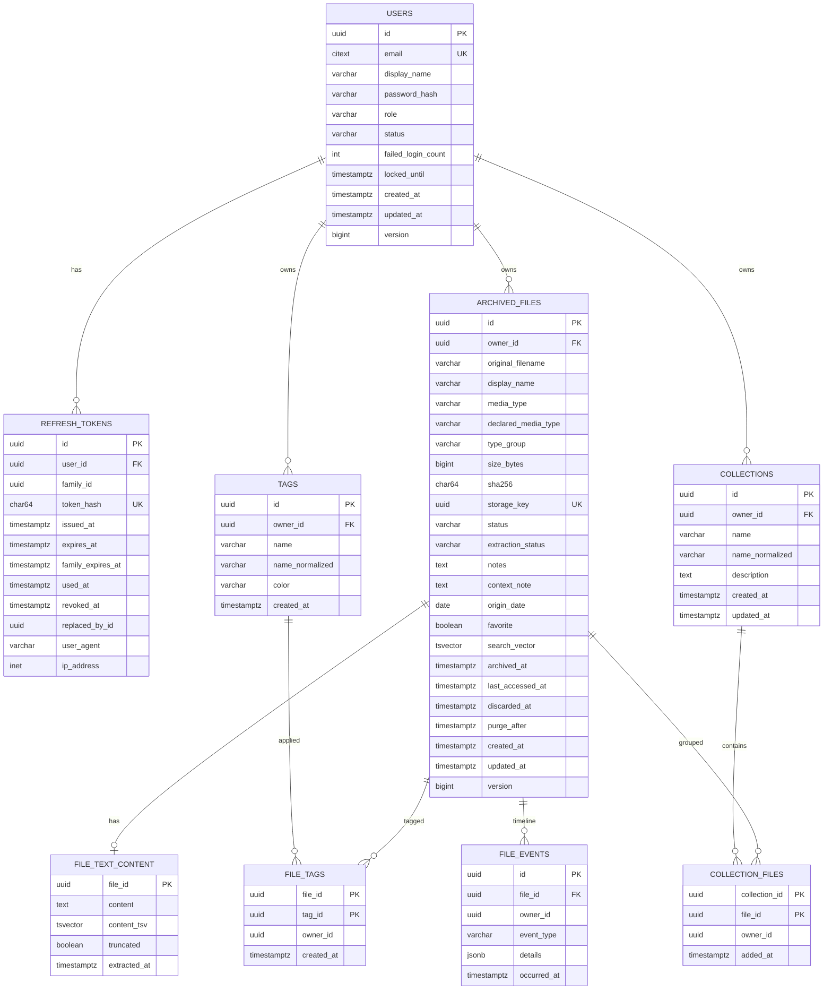
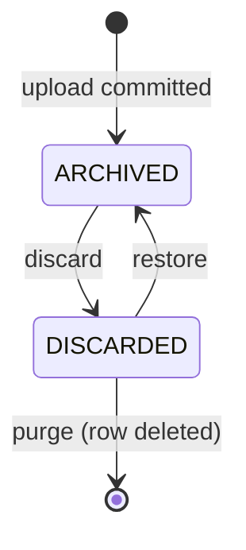

# Database design

| | |
|---|---|
| **Status** | Approved baseline v1.0 (2026-11-15) |
| **Engine** | PostgreSQL 16+ |
| **Migrations** | Flyway (`backend/src/main/resources/db/migration`), Hibernate `ddl-auto=validate` |
| **Related** | [SYSTEM_ARCHITECTURE](SYSTEM_ARCHITECTURE.md) · [SECURITY_GUIDELINES](SECURITY_GUIDELINES.md) |

## 1. Conventions

- **Identifiers:** `uuid` primary keys generated by the application (Hibernate `@UuidGenerator`, random
  v4). A UUID is an identifier, never authorization.
- **Time:** `timestamptz` in UTC. Columns `created_at`, `updated_at` where rows are mutable.
- **Enumerations:** `varchar` + `CHECK (... IN (...))`, not PostgreSQL `ENUM` types, so values can evolve
  by migration without type surgery. Java enums map by `EnumType.STRING`.
- **Optimistic locking:** `version bigint` on mutable aggregates (`users`, `archived_files`).
- **Naming:** `snake_case`, plural table names, `<table_singular>_id` for foreign keys.
- **Ownership:** every owned table carries `owner_id`. Join tables carry it too and use **composite
  foreign keys** so the database itself refuses cross-owner links.
- **Extensions:** `citext`, `pg_trgm` (both *trusted* extensions in PostgreSQL 13+).
- **Text search configuration:** `english`. Changing it requires a reindexing migration.

## 2. ER diagram



## 3. Table definitions

Legend: `NN` NOT NULL · `UQ` unique · `FK` foreign key. Only constraints worth stating are listed; every
`NN` column has no default unless stated.

### 3.1 `users`

| Column | Type | Constraints / notes |
|---|---|---|
| `id` | uuid | PK |
| `email` | varchar(254) | NN, UQ. Stored lower-cased by the application; `CHECK (email = lower(email))` |
| `display_name` | varchar(100) | NN |
| `password_hash` | varchar(255) | NN. `{bcrypt}`-prefixed (DelegatingPasswordEncoder) |
| `role` | varchar(20) | NN, CHECK in (`USER`, `ADMIN`) |
| `status` | varchar(20) | NN, default `ACTIVE`, CHECK in (`ACTIVE`, `DISABLED`) |
| `failed_login_count` | int | NN, default 0 |
| `locked_until` | timestamptz | nullable |
| `created_at`, `updated_at` | timestamptz | NN |
| `version` | bigint | NN, default 0 |

### 3.2 `refresh_tokens`

| Column | Type | Constraints / notes |
|---|---|---|
| `id` | uuid | PK |
| `user_id` | uuid | NN, FK → `users` ON DELETE CASCADE |
| `family_id` | uuid | NN. One family per login; all rotations share it |
| `token_hash` | varchar(64) | NN, UQ, CHECK 64 hex chars. Hex SHA-256 of the opaque token. **The token itself is never stored** |
| `issued_at` | timestamptz | NN |
| `expires_at` | timestamptz | NN. Sliding (per token) |
| `family_expires_at` | timestamptz | NN. Absolute cap, copied unchanged through rotations |
| `used_at` | timestamptz | set when rotated; a second presentation is *reuse* |
| `revoked_at` | timestamptz | set on logout / reuse detection / password change |
| `replaced_by_id` | uuid | successor token in the chain |
| `user_agent` | varchar(255) | informational, truncated |
| `ip_address` | varchar(45) | informational (see [SECURITY_GUIDELINES §3.5](SECURITY_GUIDELINES.md#35-client-ip)) |

Indexes: `(user_id)`, `(family_id)`, `(expires_at)` (cleanup job).

### 3.3 `archived_files`

| Column | Type | Constraints / notes |
|---|---|---|
| `id` | uuid | PK; also `UNIQUE (id, owner_id)` for composite FKs |
| `owner_id` | uuid | NN, FK → `users` |
| `original_filename` | varchar(255) | NN. As uploaded; **display only**, never a path |
| `display_name` | varchar(255) | NN. User-editable; defaults to the original name |
| `media_type` | varchar(127) | NN. **Detected** by Tika |
| `declared_media_type` | varchar(255) | client-declared type, kept for diagnostics only |
| `type_group` | varchar(20) | NN, CHECK in (`IMAGE`, `DOCUMENT`, `SPREADSHEET`, `PRESENTATION`, `TEXT`, `AUDIO`, `VIDEO`, `ARCHIVE`, `OTHER`). Derived from `media_type` at upload; makes filtering indexable |
| `size_bytes` | bigint | NN, CHECK `>= 0` |
| `sha256` | char(64) | NN, CHECK `~ '^[0-9a-f]{64}$'`. Server-computed |
| `storage_key` | uuid | NN, UQ. The only value that maps to a disk path |
| `status` | varchar(20) | NN, CHECK in (`ARCHIVED`, `DISCARDED`) |
| `extraction_status` | varchar(20) | NN, CHECK in (`PENDING`, `DONE`, `SKIPPED`, `FAILED`) |
| `notes` | text | CHECK `char_length <= 10000` |
| `context_note` | text | CHECK `char_length <= 2000` |
| `origin_date` | date | nullable |
| `favorite` | boolean | NN, default false |
| `search_vector` | tsvector | NN, default empty. Owned by `SearchIndexer` |
| `archived_at` | timestamptz | NN |
| `last_accessed_at` | timestamptz | set on download/preview; drives "forgotten" |
| `discarded_at` | timestamptz | CHECK `(status = 'DISCARDED') = (discarded_at IS NOT NULL)` |
| `purge_after` | timestamptz | set with `discarded_at`; NULL when retention is `0` |
| `created_at`, `updated_at` | timestamptz | NN |
| `version` | bigint | NN, default 0 |

State machine (enforced in the service layer **and** by the CHECK above):



Indexes:

| Index | Purpose |
|---|---|
| `(owner_id, status, archived_at DESC)` | default list |
| `(owner_id, sha256)` — **not unique** | duplicate lookup ("keep both" is allowed) |
| `(owner_id, type_group, status)` | type filter |
| `(owner_id, status, last_accessed_at)` | "forgotten" |
| `(owner_id, origin_date)` | "on this day" |
| GIN `(search_vector)` | full-text search |
| GIN `(display_name gin_trgm_ops)` | partial filename matching |
| partial `(purge_after) WHERE status = 'DISCARDED'` | retention job |

### 3.4 `file_text_content`

| Column | Type | Notes |
|---|---|---|
| `file_id` | uuid | PK, FK → `archived_files(id)` ON DELETE CASCADE |
| `content` | text | NN. Capped at `TRASHBIN_EXTRACTION_MAX_CHARS` |
| `content_tsv` | tsvector | `GENERATED ALWAYS AS (to_tsvector('english', content)) STORED`; GIN index |
| `truncated` | boolean | NN |
| `extracted_at` | timestamptz | NN |

Separate from `archived_files` so wide text never bloats list queries.

### 3.5 `tags`

| Column | Type | Notes |
|---|---|---|
| `id` | uuid | PK; `UNIQUE (id, owner_id)` |
| `owner_id` | uuid | NN, FK → `users` |
| `name` | varchar(50) | NN. As typed |
| `name_normalized` | varchar(50) | NN. Lower-cased, trimmed; `UNIQUE (owner_id, name_normalized)` |
| `color` | varchar(7) | nullable, CHECK `~ '^#[0-9A-Fa-f]{6}$'` |
| `created_at` | timestamptz | NN |

### 3.6 `collections`

Same shape as tags: `name varchar(100)`, `name_normalized`, `description text` (≤ 2000), timestamps,
`UNIQUE (owner_id, name_normalized)`, `UNIQUE (id, owner_id)`.

### 3.7 `file_tags` and `collection_files`

Composite primary keys `(file_id, tag_id)` and `(collection_id, file_id)`. Both carry `owner_id` and
declare **composite foreign keys**:

```
FOREIGN KEY (file_id, owner_id) REFERENCES archived_files (id, owner_id) ON DELETE CASCADE
FOREIGN KEY (tag_id,  owner_id) REFERENCES tags           (id, owner_id) ON DELETE CASCADE
```

(and the analogous pair for `collection_files`). Linking a file to another user's tag is therefore
impossible at the database level. Index `(tag_id)` and `(collection_id)` for reverse lookups.

### 3.8 `file_events`

Append-only activity log. `file_id` + `owner_id` with composite FK ON DELETE CASCADE (purging a file
removes its history; this is intentional and documented in the UI confirmation).

| Column | Notes |
|---|---|
| `event_type` | CHECK in (`ARCHIVED`, `METADATA_EDITED`, `DOWNLOADED`, `PREVIEWED`, `DISCARDED`, `RESTORED`, `INTEGRITY_VERIFIED`) |
| `details` | `jsonb`, small, non-sensitive (e.g., changed field names, not values) |
| `occurred_at` | NN. Index `(file_id, occurred_at DESC)` |

## 4. Referential behavior summary

| Parent delete | Effect |
|---|---|
| `archived_files` row | cascades to `file_text_content`, `file_tags`, `collection_files`, `file_events` |
| `tags` row | cascades to `file_tags` |
| `collections` row | cascades to `collection_files` |
| `users` row | cascades to `refresh_tokens`; owned content must be purged first (no user deletion in v1) |

## 5. Quota and concurrency

- **Quota** = `SUM(size_bytes)` over the owner's rows (both statuses; discarded blobs still occupy disk).
- Concurrent uploads could each pass the quota check. The upload transaction therefore takes a
  `PESSIMISTIC_WRITE` lock on the owner's `users` row before the final check-and-insert.
- Metadata edits use `version` (HTTP `If-Match`); a stale version yields `412`.

## 6. Search design

- `search_vector` = `setweight(name, 'A') || setweight(tag names || notes, 'B') || setweight(context note, 'C')`,
  recomputed by `SearchIndexer` in the same transaction as any change to those inputs (name, notes,
  context, or tag assignments, including tag rename and merge).
- Content search joins `file_text_content.content_tsv`.
- Query text is passed through `websearch_to_tsquery('english', :q)`, always as a bound parameter.
- Ranking: `ts_rank_cd` on the combined vector; ties broken by `archived_at DESC`.
- Filename fragments additionally match via `display_name % :q` / `ILIKE` using the trigram index.
- A statement timeout (e.g. 5 s) protects against pathological queries.

## 7. Data lifecycle

| Event | Database | Filesystem |
|---|---|---|
| Upload | insert `archived_files`, tags, event; extraction later inserts `file_text_content` | blob moved staging → blobs before commit |
| Discard | `status`, `discarded_at`, `purge_after`, event | none |
| Restore | clear `discarded_at`/`purge_after`, `status = ARCHIVED`, event | none |
| Purge / retention | delete row (cascade) | blob deleted `afterCommit`; failures cleaned by reconciler |
| Password change / logout-all | set `revoked_at` on the user's refresh tokens | none |

## 8. Migration rules

1. File naming: `V{n}__{snake_case_description}.sql`; sequential integers.
2. **Never edit a merged migration.** Fix forward with a new one.
3. One concern per migration; DDL and data backfills in separate files.
4. Every migration is tested on an empty database and on the previous version's schema.
5. Hibernate does not generate schema (`ddl-auto=validate`); mapping/schema drift fails startup and tests.
6. Planned baseline sequence (finalized per milestone):

| Version | Content | Milestone |
|---|---|---|
| `V1__extensions.sql` | `citext`, `pg_trgm` | M0 |
| `V2__users_and_refresh_tokens.sql` | auth tables | M1 |
| `V3__archived_files_and_events.sql` | files, text content, events | M2 |
| `V4__tags_and_collections.sql` | tags, collections, join tables | M3 |
| `V5__search_indexes.sql` | GIN/trigram indexes | M3 |
| `V6__lifecycle_indexes.sql` | retention/rediscover indexes | M5 |
