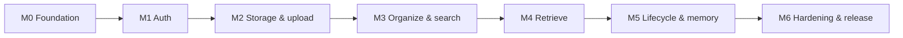

# Development roadmap

| | |
|---|---|
| **Status** | Approved baseline v1.0 (2026-11-15) |
| **Approach** | Vertical slices: each milestone delivers backend, database and UI together, behind its own definition of done. |
| **Related** | [PROJECT_REQUIREMENTS](PROJECT_REQUIREMENTS.md) · [CONTRIBUTING](../CONTRIBUTING.md) · [SECURITY_GUIDELINES](SECURITY_GUIDELINES.md) |

## Overview

Milestones are sequential. A milestone starts only when the previous one's definition of done is met.
Scope changes go through an ADR or an update to this document in the same PR.

## Global definition of done (applies to every milestone)

In addition to each milestone's own list, **every** milestone requires:

- [ ] All changes merged to `main` via reviewed PRs (self-review checklist complete)
- [ ] `backend: mvnw verify` and `frontend: lint + typecheck + test` green on a clean checkout
- [ ] No compiler/TypeScript/ESLint warnings; formatters clean
- [ ] Coverage gates from [CODING_STANDARDS §E](CODING_STANDARDS.md#testing-expectations) hold
- [ ] Cross-tenant tests exist for every owned endpoint added
- [ ] Documentation updated (API_CONTRACT, DATABASE_DESIGN, SYSTEM_ARCHITECTURE, config reference) and consistent with the code
- [ ] OpenAPI snapshot regenerated and committed (from M0 on)
- [ ] No secrets, filenames or tokens in code, tests, logs or docs
- [ ] Manual smoke test of the milestone's user journey on Windows, from a fresh database, recorded in the PR
- [ ] Known issues listed in the milestone's closing PR; none that violate a requirement or security rule

---

## M0 — Foundation

**Goal:** a working skeleton on Windows with all engineering rails in place and the main technical risks de-risked. No business features.

**Scope**
- `backend/` Maven project (Java 21, Spring Boot 3.x), Maven Wrapper, Spotless, `-Xlint:all -Werror`, JaCoCo
- `frontend/` Next.js (App Router, strict TS), Tailwind, shadcn/ui, Lucide, ESLint, Prettier, Vitest, Playwright config
- Profiles `dev`/`test`/`prod`; typed `@ConfigurationProperties`; startup validation of required config
- `.env.example` files for backend and frontend; `.env` loading verified
- Flyway baseline (`V1__extensions.sql`); Hibernate `validate`; test database wiring
- Error model (`TrashBinException`, `ErrorCode`, problem+json advice), trace id + MDC, structured logging in `prod`
- Security baseline: deny-by-default filter chain, security headers, actuator locked down, placeholder `/health`
- springdoc + OpenAPI snapshot test + `api:types` script
- ArchUnit skeleton (layering, module boundaries)
- Next `/api/*` rewrite to the backend
- **Decisions and spikes:** (1) confirm the Spring Boot 3.x line is still supported and pin the version, or raise
  ADR-002; (2) spike: 250 MB multipart upload and slow response through the Next proxy; (3) spike:
  `X-Forwarded-For` propagation and trusted-proxy handling; (4) choose and record the admin bootstrap and
  password-recovery mechanism (ADR-003)

**Definition of done**
- [ ] Both apps start from the README steps alone on a clean Windows machine
- [ ] `GET /actuator/health` returns `UP` via the Next proxy; DB connectivity verified
- [ ] Backend refuses to start with a missing/short/duplicate/placeholder secret (tested)
- [ ] A sample error response is valid problem+json with `traceId`; unexpected exception returns generic 500 (tested)
- [ ] ArchUnit, Spotless and compiler-warning gates are active and failing correctly when violated
- [ ] OpenAPI snapshot test and TypeScript type generation work end to end
- [ ] Spike results (upload through proxy, forwarded headers) recorded; any needed change to the architecture is in an ADR
- [ ] Spring Boot version decision recorded (ADR-002); admin bootstrap/recovery recorded (ADR-003)
- [ ] CI-less local scripts documented in README; `.gitattributes`/line-ending policy decided and applied

---

## M1 — Authentication

**Goal:** secure accounts and sessions. Requirements: FR-A1 – FR-A5.

**Scope**
- Flyway `V2`: `users`, `refresh_tokens`
- Register (config-gated), login, refresh with rotation + reuse detection + grace window, logout, logout-all
- Profile update, password change, session list/revoke
- BCrypt (cost 12) with the 72-byte rule; lockout; per-IP throttle with trusted forwarded headers
- JWT resource-server config; deny-by-default authorization; admin role checks on actuator
- Frontend: login/register pages, `AuthProvider`, in-memory token, single-flight refresh with Web Locks, `AuthGate`, settings page (profile, password, sessions)

**Definition of done**
- [ ] Every item in [SECURITY_GUIDELINES §3](SECURITY_GUIDELINES.md#3-authentication) implemented and tested
- [ ] Tests: rotation, reuse revokes family, grace window, expiry (sliding and absolute), logout/logout-all, password change revokes sessions, lockout, uniform `INVALID_CREDENTIALS`, 72-byte limit, Origin/header checks on cookie endpoints
- [ ] Refresh cookie attributes verified in a browser (HttpOnly, SameSite=Strict, Path)
- [ ] Multi-tab refresh race manually verified; no spurious logout
- [ ] No token in `localStorage`/`sessionStorage`/URL/logs (grep + review)
- [ ] Per-IP throttling verified through the proxy
- [ ] Playwright: register → login → session persists across reload → logout

---

## M2 — Storage and upload

**Goal:** safely archive files. Requirements: FR-F1 – FR-F4, FR-F7, FR-V1 (basic).

**Scope**
- Flyway `V3`: `archived_files`, `file_text_content` (empty use), `file_events`
- `BlobStore` port + `LocalFsBlobStore`; staging; atomic move; startup storage validation; reconciler + admin trigger
- Upload pipeline: size cap on stream, SHA-256, Tika signature detection, policy/denylist, `UploadScanner` hook, duplicate policy, quota with row lock, compensation on DB failure
- List and detail endpoints (basic sort/pagination); activity event `ARCHIVED`
- Frontend: upload dropzone and queue (progress, cancel, duplicate prompt), archive list, file detail (read-only)

**Definition of done**
- [ ] Upload tests: oversize stream, header/body size mismatch, signature mismatch, traversal-style and control-character filenames, duplicate (allow/deny), quota exceeded, concurrent-upload quota race, DB failure leaves no orphan blob
- [ ] Path-handling tests: normalization, symlink rejection, UUID-key validation
- [ ] Reconciler removes aged staging files and orphan blobs, reports missing blobs (tested)
- [ ] Verified on Windows: atomic move on the configured volume; startup check fails clearly across volumes
- [ ] Large-file upload (≥ 200 MB) works through the proxy with bounded heap use
- [ ] Cross-tenant tests for list and detail
- [ ] Upload journey passes in Playwright

---

## M3 — Organize and search

Delivered in two parts: **M3a** (tags, favorites, metadata editing) and **M3b** (collections,
full-text search, filters). **Both done.** Measured: search p95 146–279 ms at 10,000 files (budget 300 ms).

**Goal:** find things. Requirements: FR-O1 – FR-O6 (FR-O3 for metadata; content search completes in M4).

**Scope**
- Flyway `V4`/`V5`: tags, collections, join tables with composite FKs, search indexes
- Tags (CRUD, merge, assign) and collections; favorites; metadata edit with `If-Match`
- `SearchIndexer`, list filters (tag AND, type group, date range, favorite, collection), ranked search, trigram filename match, statement timeout
- Frontend: search bar, filter panel with URL-synced state, tag/collection management, metadata editor with conflict handling

**Definition of done**
- [ ] Composite-FK tests prove a file cannot be linked to another owner's tag/collection (DB level and API level)
- [ ] Search/filters tested for correctness and owner isolation; tag rename/merge reindexes `search_vector`
- [ ] `If-Match` conflict returns 412 and the UI offers reload
- [ ] NFR-P1 measured on a 10,000-file seed: list and search p95 < 300 ms (numbers recorded in the PR)
- [ ] Query-count assertions show no N+1 on list endpoints
- [ ] Filters survive reload and back/forward (Playwright)

---

## M4 — Retrieve

Delivered in two parts: **M4a** (signed download/preview links, Range support, preview UI) and
**M4b** (Tika text extraction and content search). **Both done.**

**Goal:** get files back safely. Requirements: FR-V2, FR-V3, FR-F5, FR-O3 (content search).

**Scope**
- Access tickets (download 60 s, preview 5 min), `GET /content/{ticket}` with `Range`/ETag
- Preview allowlist (PNG/JPEG/GIF/WebP, text, **PDF per ADR-004**); everything else attachment
- Tika text extraction: allowlist, caps, timeout, bounded executor, `extraction_status`; content FTS
- Frontend: download action, preview dialog/page (image, text, PDF), extraction status indicator
- **Spike/decision:** PDF preview strategy (browser-native with adjusted CSP vs bundled viewer) → ADR-004

**Definition of done**
- [ ] Ticket tests: tamper, expiry, wrong purpose, wrong user, purged file, missing file → `TICKET_INVALID`/404; tickets never usable without DB re-check
- [ ] Header tests: `nosniff`, `no-store`, CSP, `Content-Disposition` injection attempts, SVG/HTML always attachment
- [ ] Range requests verified (partial content, invalid range)
- [ ] Extraction tests: zip-bomb-like and oversized fixtures are skipped/failed safely; timeout enforced; app remains healthy
- [ ] Content search finds extracted text; discarded/other-owner files excluded appropriately
- [ ] PDF preview decision recorded (ADR-004) and verified in Chrome, Edge, Firefox
- [ ] Download and preview journeys pass in Playwright

---

## M5 — Lifecycle and memory

**Goal:** the "nothing is trash until you decide" lifecycle, plus rediscovery. Requirements: FR-L1 – FR-L4, FR-F6, FR-M1 – FR-M5.

**Scope**
- Flyway `V6`; discard / restore / purge endpoints and UI (Discarded view, countdown, confirmation)
- Retention job (batched, configurable, `0` disables); `afterCommit` blob deletion; reconciler interplay
- Events timeline; integrity verify; rediscover (`on-this-day`, `forgotten`, `random`); stats and quota display

**Definition of done**
- [ ] State-machine tests: every valid and invalid transition (API and CHECK constraint)
- [ ] Retention job tested with an injected `Clock`: purges only expired discarded files; `TRASHBIN_RETENTION_DAYS=0` disables; batches; logs summary
- [ ] Purge removes row, cascades, and blob; failed blob deletion is later reconciled (tested)
- [ ] Integrity verify detects a deliberately corrupted blob
- [ ] Rediscovery queries tested for owner isolation and edge dates (leap day, year boundary)
- [ ] **Cross-tenant suite covers every endpoint in the API contract**
- [ ] Full journey passes in Playwright: upload → discard → restore → discard → purge

---

## M6 — Hardening and release

**Goal:** make v1 trustworthy and operable.

**Scope**
- Complete E2E suite; accessibility pass (axe + keyboard walkthrough); responsive review (360 px)
- Dependency audits (`npm audit`, Maven dependency-check); security header review; `prod` profile verification
- Backup and restore procedure written and executed; operations notes (reconcile, retention, secret rotation)
- Documentation sweep; final consistency review across `docs/`; v1.0 tag

**Definition of done**
- [ ] [SECURITY_GUIDELINES §12](SECURITY_GUIDELINES.md#12-release-security-checklist) fully checked
- [ ] All **M** requirements in PROJECT_REQUIREMENTS verified, with test or manual evidence recorded
- [ ] Playwright full journey green on a fresh database and storage directory
- [ ] axe reports no serious/critical violations on core screens; keyboard-only walkthrough passes
- [ ] Backup → wipe → restore executed successfully; integrity verify passes on all restored files
- [ ] `prod` profile smoke test: Swagger unreachable, actuator restricted, JSON logs, `Secure` cookie, HSTS when HTTPS
- [ ] Open ADR items (002–004) closed; docs contain no stale statements
- [ ] Version `v1.0.0` tagged with release notes

---

## Post-v1 backlog (not committed)

Image thumbnails (FR-V4) · bulk ZIP export · email-based verification/password reset · malware scanner
adapter · out-of-process Tika · application-level encryption in `BlobStore` · workspaces and sharing ·
Argon2id migration · BFF token model if server-side rendering of authenticated pages is needed.
