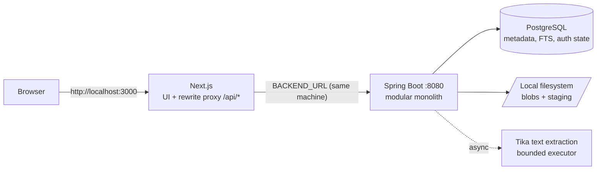
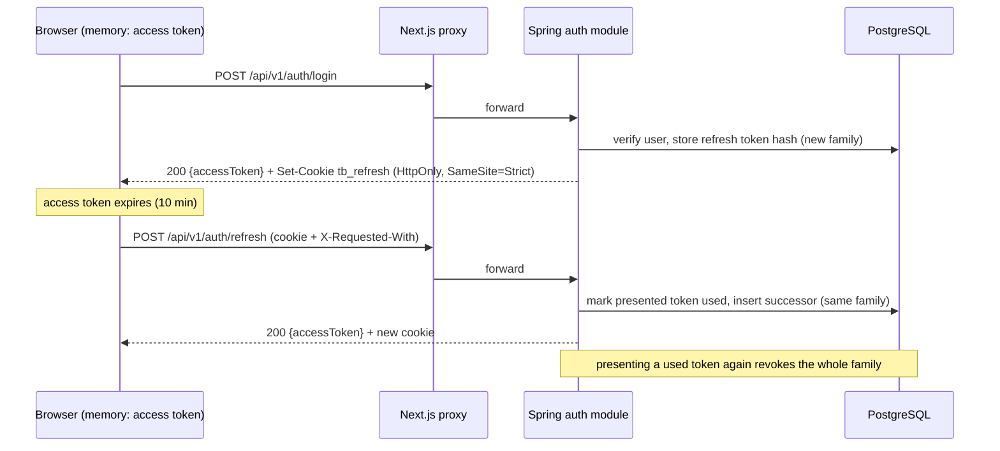

# System architecture

| | |
|---|---|
| **Status** | Approved baseline v1.0 (2026-11-15) |
| **Related** | [ADR-001](DECISIONS/ADR-001-architecture.md) · [DATABASE_DESIGN](DATABASE_DESIGN.md) · [API_CONTRACT](API_CONTRACT.md) · [SECURITY_GUIDELINES](SECURITY_GUIDELINES.md) |

## 1. Overview

A **modular monolith** (Spring Boot) serves a REST API. A **Next.js** application serves the UI and
proxies `/api/*` to the backend so the browser sees a single origin. Metadata and search live in
PostgreSQL; file bytes live on the local filesystem behind a storage port.



### Why this shape

| Decision | Reason |
|---|---|
| Modular monolith | One deployable, simple local operation, boundaries still enforced (ArchUnit). |
| Next.js proxies `/api/*` | One origin means a first-party refresh cookie and no CORS dependency; backend stays independent. |
| Metadata in DB, bytes on disk | Streaming large files from DB is costly; a `BlobStore` port allows swapping storage later. |
| PostgreSQL FTS | Proportionate at this scale; transactional with the data; no extra service. |
| Async only for extraction | Slow, failure-prone work off the request path; no broker needed. |

## 2. Backend

### 2.1 Module map

Root package `app.trashbin`, packaged **by feature**. Each module contains `web`, `service`, `domain`,
`repository`, `dto`, `mapper` as needed.

```
app.trashbin
 ├─ common/        error model (ProblemDetail + ErrorCode), exceptions, Clock/id support,
 │                 logging + MDC, PageResponse
 ├─ config/        SecurityConfig, JwtConfig, OpenApiConfig, executors, @ConfigurationProperties records
 ├─ auth/          AuthController, AuthService, TokenService, RefreshTokenService, LoginThrottle
 ├─ user/          User aggregate, profile, password change, sessions
 ├─ archive/       ArchivedFile aggregate
 │   ├─ upload/    UploadService, validation pipeline, duplicate policy
 │   ├─ lifecycle/ discard / restore / purge, RetentionJob
 │   ├─ search/    SearchQueryBuilder, SearchIndexer
 │   └─ access/    AccessTicketService, ContentController (streaming)
 ├─ tag/  collection/
 ├─ rediscover/    on-this-day, forgotten, random
 ├─ activity/      file_events recording + timeline
 ├─ storage/       BlobStore (port), LocalFsBlobStore (adapter), StorageReconciler
 ├─ content/       MediaTypeDetector (Tika), TextExtractionService
 └─ stats/
```

### 2.2 Layer rules

| Layer | May depend on | Responsibility |
|---|---|---|
| `web` | `service`, `dto` | HTTP mapping only. No logic, no transactions, no entities. |
| `service` | `repository`, `domain`, `mapper`, other modules' **service interfaces** | Transactions, ownership checks, business rules. |
| `repository` | `domain` | Spring Data JPA. Owner-scoped queries only for owned entities. |
| `domain` | nothing app-specific | Entities and invariants. Never exposed outside the module. |
| `dto` / `mapper` | `domain` (mapper only) | Immutable records, explicit mapping. |

ArchUnit tests enforce: layering, no cross-module repository access, no entities in controller
signatures, and no plain `findById` on owned entities.

### 2.3 Cross-cutting

- **Transactions** on service methods (`readOnly = true` for queries). Never held across file IO
  beyond what the upload protocol specifies (see §5).
- **Errors:** RFC 9457 `application/problem+json` via one `@RestControllerAdvice`. See
  [API_CONTRACT §4](API_CONTRACT.md#4-error-model).
- **Logging:** SLF4J, JSON in `prod` profile (Spring Boot structured logging), MDC keys `traceId` and
  `userId`. Never log tokens, passwords, file names, or file content.
- **Time:** inject `java.time.Clock`; all timestamps UTC (`timestamptz`).
- **Virtual threads** are not required; the extraction executor is a bounded pool.
- **OpenAPI:** springdoc generates the spec; a test writes a committed snapshot to
  `backend/openapi/openapi.json`, from which the frontend generates its TypeScript types. Swagger UI is
  enabled only in the `dev` profile.

## 3. Frontend

### 3.1 Rendering model

Public pages (landing, login, register) are server components. The authenticated application is a
**client-rendered shell** behind an `AuthGate`, because the access token is held **in memory only** and
is therefore unavailable to server components. Server state is managed by TanStack Query.

A Next.js Backend-for-Frontend that holds tokens in cookies is a documented alternative that was
deliberately not chosen for v1 (see ADR-001 AD-4).

### 3.2 Structure

```
frontend/src/
  app/                      routes only: layouts, pages, loading.tsx, error.tsx
    (public)/               login, register
    (app)/                  archive, files/[id], discarded, tags, collections, rediscover, settings
  features/
    auth/  files/  search/  tags/  collections/  rediscover/  dashboard/
      api/  hooks/  components/  schemas/  index.ts
  components/ui/            shadcn primitives (owned code)
  lib/
    api/                    fetch client, ApiError, problem+json parser, generated types
    config/  utils/
```

Rules are in [CODING_STANDARDS Part C](CODING_STANDARDS.md#part-c--frontend-standards). In brief:
features import each other only via `index.ts`; server state lives only in TanStack Query; search
filters live in the URL; business rules are never duplicated from the backend, only mirrored as UX hints.

### 3.3 Proxying

`next.config` rewrites `/api/:path*` to `${BACKEND_URL}/api/:path*`. No Next.js middleware runs on
`/api` routes. The proxy must forward `Origin`, `Cookie`, `Authorization` and `X-Forwarded-For`; this
is **assumed, not yet verified**, and is checked in the M0 spike.

**Exception: `/api/v1/files`.** The rewrite proxy buffers request bodies in memory and truncates them
beyond 10 MB, which breaks large uploads (found by the M2 spike). That one path is served by a streaming
route handler (`frontend/src/app/api/v1/files/route.ts`) that pipes the body to the backend. Measured:
a 200 MB upload completes in ~2.5 s locally with flat memory in both processes.

## 4. Runtime flows

### 4.1 Session lifecycle



### 4.2 Upload

```mermaid
sequenceDiagram
  participant U as Browser
  participant C as UploadController
  participant S as UploadService
  participant B as BlobStore
  participant D as PostgreSQL
  participant X as Extraction (async)
  U->>C: POST /files (multipart: file + metadata)
  C->>S: upload(user, stream, metadata)
  S->>S: size/quota precheck
  S->>B: write to staging (hash + count bytes in one pass)
  S->>S: Tika signature check, policy, denylist
  S->>D: duplicate lookup (owner, sha256)
  alt duplicate and not allowed
    S-->>U: 409 DUPLICATE_FILE (+ existing summary)
  else accepted
    S->>B: atomic move staging -> blobs/ab/cd/key
    S->>D: BEGIN; insert file, tags, event, search vector; COMMIT
    Note over S,B: if the DB step fails, delete the blob (compensation)
    S-->>U: 201 FileDetail
    S-)X: after commit: schedule extraction
  end
```

### 4.3 Download / preview

1. `POST /files/{id}/access-tickets` (bearer-authenticated, owner-checked) returns `{url, expiresAt}`.
2. The browser requests `GET /api/v1/content/{ticket}` natively (anchor navigation or ``/`<iframe>`).
3. The server verifies the HMAC signature, expiry and purpose, **re-checks that the file still exists,
   is owned by the ticket's user and is not purged**, then streams the blob with `Range` support.

## 5. File storage

```
${TRASHBIN_STORAGE_ROOT}/        e.g. D:\TrashBinData   (outside the repository)
  staging/                       in-flight uploads; swept hourly
  blobs/ab/cd/<storageKey>       final blobs, sharded by key prefix, no extension
```

- On-disk names are **only** server-generated UUIDs. User filenames and extensions never touch the filesystem.
- Path safety: resolve → normalize → assert prefix of root → reject symlinks. Keys are validated as UUIDs.
- `staging/` and `blobs/` must be on the same volume (checked at startup) so the final move is atomic.
- **Consistency protocol:** the blob is moved into place *before* the DB commit; a failed commit deletes
  it. Purge deletes the row in a transaction and the blob `afterCommit`. A failed blob delete leaves an
  orphan that the **reconciler** removes (orphans older than 1 h) and logs. Rows whose blob is missing are
  *reported*, never auto-deleted.
- No cross-user physical deduplication (avoids existence leaks and shared-deletion complexity).
- Backup: stop or quiesce the app, then copy the `pg_dump` output and the storage root together.

## 6. Search

PostgreSQL full-text search. `archived_files.search_vector` (name A, tags/notes B, context note C) is
maintained by `SearchIndexer` in the same transaction as metadata changes. Extracted text is searched
through `file_text_content.content_tsv`. Queries use `websearch_to_tsquery`; filename partial matching
uses a `pg_trgm` index. Details in [DATABASE_DESIGN §6](DATABASE_DESIGN.md#6-search-design).

## 7. Background work

| Job | Trigger | Behavior |
|---|---|---|
| Text extraction | after upload commit | Bounded executor; type allowlist; input/output/time caps; sets `extraction_status`. |
| Retention purge | daily schedule | Purges `DISCARDED` rows with `purge_after < now`, in batches; logs a summary. |
| Storage reconciler | hourly + admin-triggered | Removes old staging files and orphan blobs; reports missing blobs. |
| Token cleanup | daily | Deletes expired refresh tokens. |

## 8. Profiles

| Profile | Purpose | Differences |
|---|---|---|
| `dev` | Day-to-day development | Swagger UI on; readable logs; `TRASHBIN_COOKIE_SECURE=false` allowed. |
| `test` | Automated tests | Isolated DB and temp storage dir; deterministic clock where needed. |
| `prod` | Hardened local run | Swagger off; JSON logs; actuator restricted; cookie `Secure`; HSTS when served over HTTPS. |

## 9. Configuration reference

The backend reads configuration from environment variables, optionally via `backend/.env` (loaded with
`spring.config.import=optional:file:.env[.properties]` when started from `backend/`). `application.yml`
references each variable explicitly (`${TRASHBIN_...}`). Real environment variables take precedence over `.env`.

### Backend

| Variable | Required | Default | Description |
|---|---|---|---|
| `SPRING_PROFILES_ACTIVE` | no | `dev` | `dev`, `test` or `prod`. |
| `TRASHBIN_DB_URL` | yes | – | JDBC URL, e.g. `jdbc:postgresql://localhost:5432/trashbin_db`. |
| `TRASHBIN_DB_USERNAME` | yes | – | Database role. |
| `TRASHBIN_DB_PASSWORD` | yes | – | Database password. |
| `TRASHBIN_JWT_SECRET` | yes | – | Base64, ≥ 32 decoded bytes. Signs access tokens. Startup fails if absent, short or a known placeholder. |
| `TRASHBIN_TICKET_SECRET` | yes | – | Base64, ≥ 32 decoded bytes. Signs access tickets. **Must differ** from the JWT secret. |
| `TRASHBIN_STORAGE_ROOT` | yes | – | Absolute path of the blob root. Created if missing; must be writable. |
| `TRASHBIN_ALLOWED_ORIGIN` | no | `http://localhost:3000` | Exact origin allowed for cookie endpoints and CORS. No wildcard. |
| `TRASHBIN_COOKIE_SECURE` | no | `false` (dev) / `true` (other) | `Secure` attribute of the refresh cookie. |
| `TRASHBIN_REGISTRATION_ENABLED` | no | `true` | Allows `POST /auth/register`. |
| `TRASHBIN_BOOTSTRAP_ADMIN_EMAIL` | no | *(empty)* | The account that registers with this email becomes `ADMIN`. |
| `TRASHBIN_AUTH_RATE_LIMIT_PER_MINUTE` | no | `10` | Per-IP request limit on `/auth/*`. |
| `TRASHBIN_ACCESS_TOKEN_TTL` | no | `PT10M` | ISO-8601 duration. |
| `TRASHBIN_REFRESH_TOKEN_TTL` | no | `P14D` | Sliding expiry per token. |
| `TRASHBIN_REFRESH_TOKEN_MAX_AGE` | no | `P30D` | Absolute cap per family. |
| `TRASHBIN_DOWNLOAD_TICKET_TTL` | no | `PT60S` | Download ticket lifetime. |
| `TRASHBIN_PREVIEW_TICKET_TTL` | no | `PT5M` | Preview ticket lifetime (viewers issue range requests). |
| `TRASHBIN_MAX_FILE_SIZE_MB` | no | `250` | Also drives the multipart limit. |
| `TRASHBIN_USER_QUOTA_GB` | no | `5` | Per-user storage quota. |
| `TRASHBIN_RETENTION_DAYS` | no | `30` | Discard retention; `0` disables auto-purge. |
| `TRASHBIN_BLOCKED_EXTENSIONS` | no | *(empty)* | Comma-separated denylist, e.g. `exe,scr`. |
| `TRASHBIN_EXTRACTION_MAX_INPUT_MB` | no | `50` | Larger files are not parsed (`SKIPPED`). |
| `TRASHBIN_EXTRACTION_MAX_CHARS` | no | `1000000` | Stored text cap. |
| `TRASHBIN_EXTRACTION_TIMEOUT` | no | `PT30S` | Per-file parse timeout. |

### Frontend (`frontend/.env.local`)

| Variable | Required | Default | Description |
|---|---|---|---|
| `BACKEND_URL` | no | `http://localhost:8080` | Server-side only. Target of the `/api/*` rewrite. **Not** prefixed with `NEXT_PUBLIC_`; nothing sensitive is ever exposed to the browser. |

### Test and E2E

| Variable | Default | Description |
|---|---|---|
| `TRASHBIN_TEST_DB_URL` / `_USERNAME` / `_PASSWORD` | – | Dedicated `trashbin_test_db` database (cleaned by Flyway per run). |
| `TRASHBIN_TEST_USE_TESTCONTAINERS` | `false` | `true` starts PostgreSQL via Testcontainers (requires Docker). |
| `E2E_BASE_URL` | `http://localhost:3000` | Playwright target. |

`*.env.example` files with placeholders are committed; real `.env` files never are.
